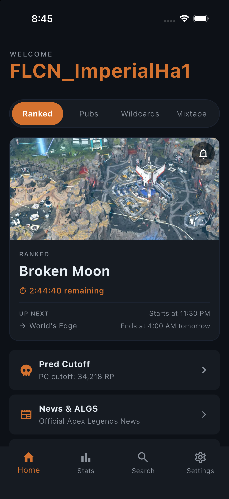
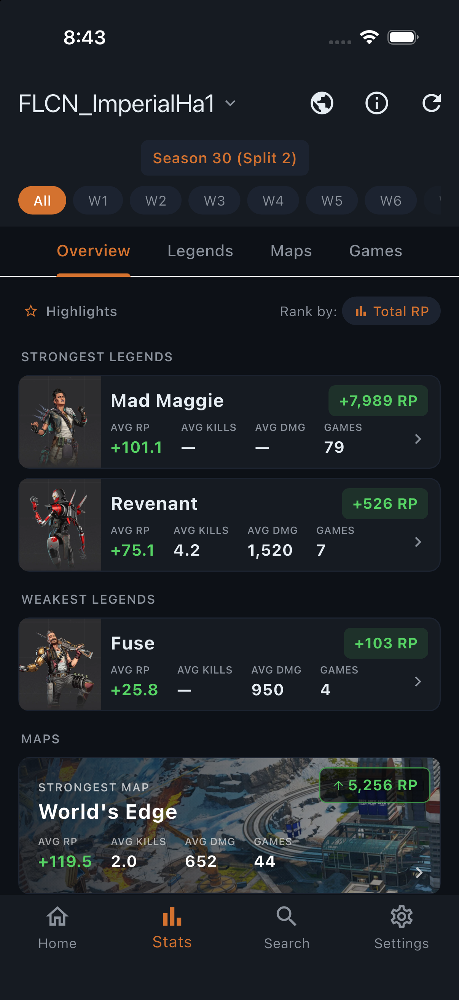
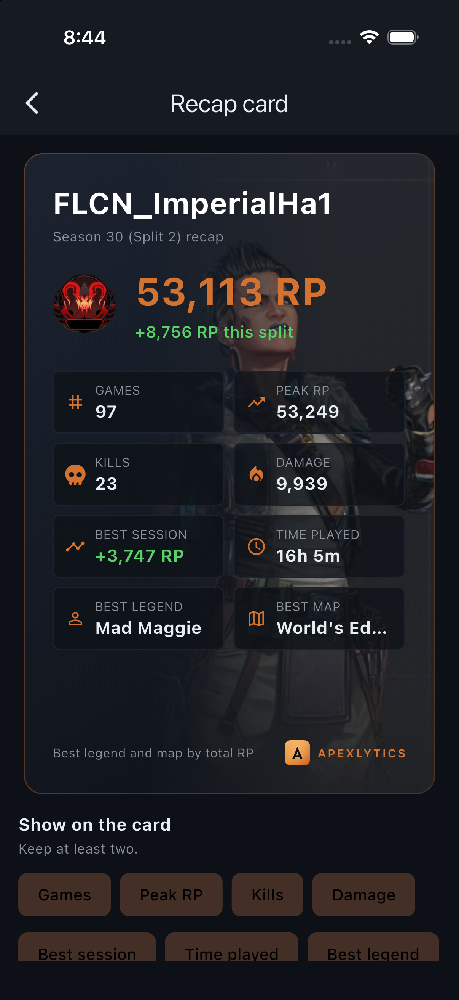
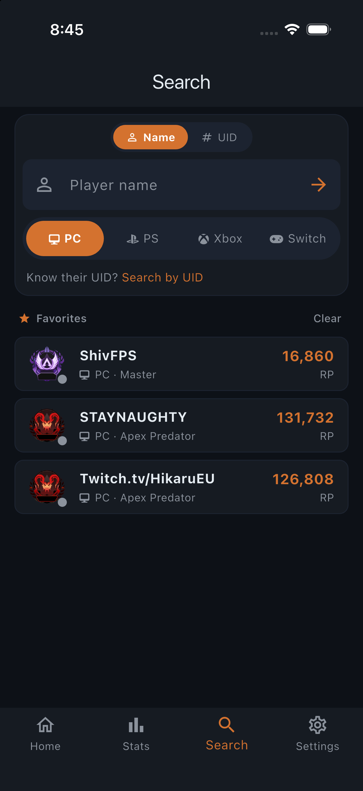
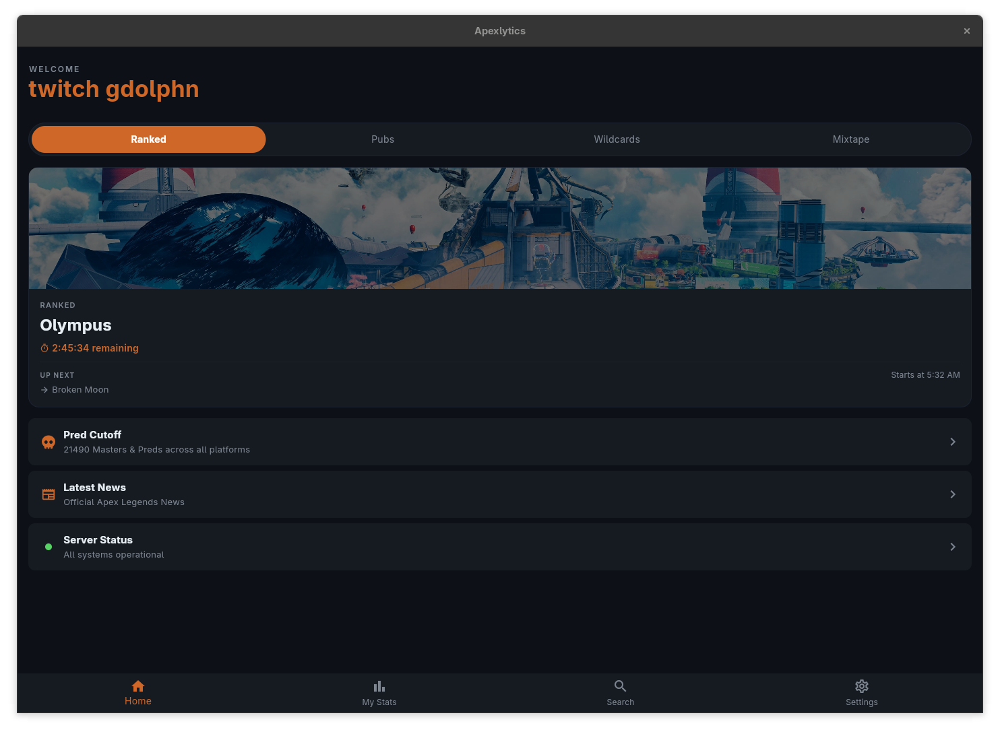
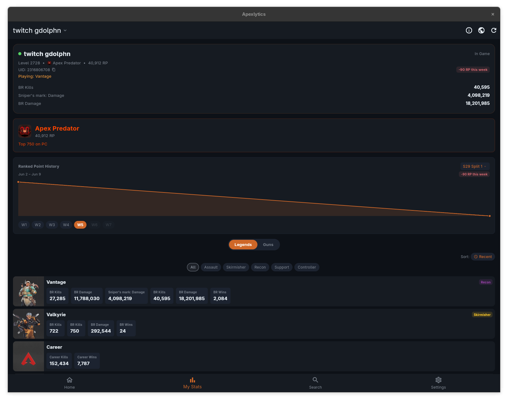
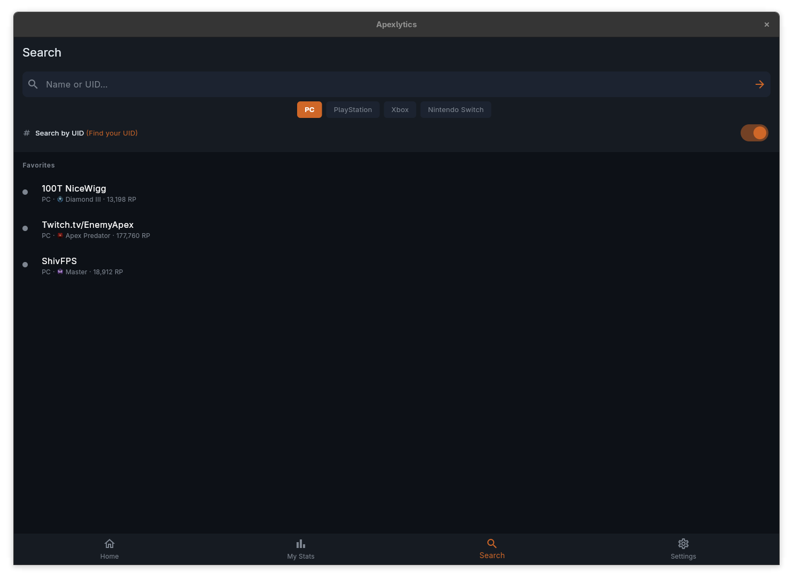
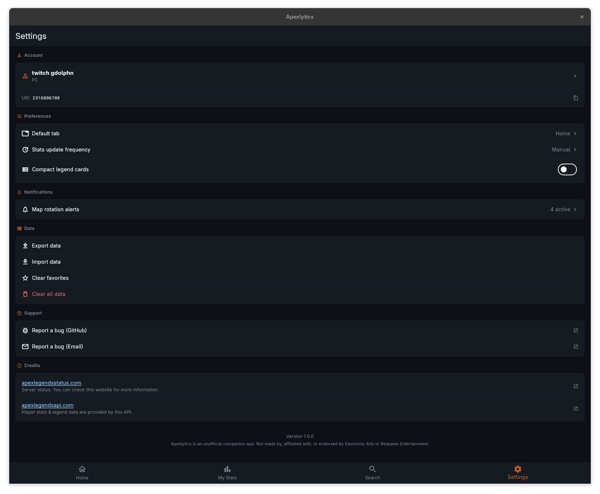

# Apexlytics

<p align="center">
  
</p>

<p align="center">
  <strong>Know the map. Track your grind. Get alerts. Your Apex sidekick.</strong><br/>
</p>

<p align="center">
  <a href="https://github.com/ajwadtahmid/Apexlytics/releases">
    
  </a>
  <a href="https://github.com/ajwadtahmid/Apexlytics/releases">
    
  </a>
  <a href="https://flutter.dev">
    
  </a>
  <a href="https://github.com/ajwadtahmid/Apexlytics/blob/main/LICENSE">
    
  </a>
  
  
  
  
</p>

---

<div align="center">

<a href="https://github.com/ajwadtahmid/Apexlytics/releases">
</a> 

<a href="https://play.google.com/store/apps/details?id=com.ajwadtahmid.apexlytics">
</a>

<a href="https://apps.apple.com/app/id6778521764">
</a>

</div>

---

## Overview

Track your ranked grind and visualize your RP gains with interactive graphs. Get instant map alerts, compare your stats with friends and rivals, and put all the data that matters at your fingertips with **Apexlytics**.

> **Disclaimer:** Unofficial fan project. Not made by, affiliated with, or endorsed by Electronic Arts or Respawn Entertainment. Apex Legends is a trademark of Electronic Arts Inc.

## Table of Contents

- [Key Features](#key-features)
- [Screenshots](#screenshots)
- [Features](#features)
- [Ranked Tracking Guide](#ranked-tracking-guide)
- [Development](#development)
- [Data & Privacy](#data--privacy)
- [Support & Feedback](#support--feedback)
- [FAQ](#faq)
- [Known Limitations](#known-limitations)
- [Changelog](#changelog)
- [Credits & Acknowledgments](#credits--acknowledgments)
- [License](#license)

---

## Key Features

- **Know the Map**: See which map is active now and preview upcoming rotations. Get instant notifications before the map changes so you're never caught off-guard mid-game.

- **Track Your Grind**: Look up any player's rank and legend statistics. Visualize your weekly RP gains with interactive graphs and compare head-to-head performance with other players across ranked seasons and splits.

- **Stats**: Your ranked climb, broken down. An RP chart, your best and worst legends and maps by the measure you choose, legend and map tables, sessions, personal records, trends and split comparison, all built from the matches Apexlytics records for you. See the [Ranked Tracking Guide](#ranked-tracking-guide) for how tracking works.

- **Favorite Players & Compare**: Add players to your favorites and track their RP progression in real-time. Compare your stats side-by-side with favorited players to monitor competition and benchmark your climb.

- **Detailed Legend Stats**: Deep-dive into legend performance with advanced metrics including damage per kill, win rate, revive rate, and more custom stats. Analyze what's working and optimize your legend pool.

- **Server Status**: Check latency across regions at a glance.

- **Fast & Simple**: Instant access to the competitive data you need. No waiting, no friction.

---

## Screenshots

| Home | Stats | Recap | Search |
|------|-------|-------|--------|
|  |  |  |  |

<details>
<summary>Desktop</summary>

| Home | Stats | Search | Settings |
|------|-------|--------|----------|
|  |  |  |  |

</details>

---

## Features

- **Player Stats**: Rank, RP, current legend, equipped trackers, and weekly RP gain tracking. Supports search by name or numeric UID.
- **RP Progression Graph**: Interactive chart of RP gained per match, built from your match history, with session filtering and split/week navigation. A snapshot-based RP graph is also available.
- **Stats** (the Stats tab): a full ranked deep-dive built from the matches Apexlytics records for you, with a split and week picker. Its four tabs:
  - **Overview**: your account, the chosen split or week (summary, RP chart and stats), highlights such as your best and worst legends and maps, ranked by a measure you choose (total or average RP, win rate, kills or damage), and a "Dig deeper" grid that opens the pages below. A first-run preview shows what it will look like while you wait for a first game.
  - **Legends** and **Maps**: per-legend and per-map breakdown tables, sortable by RP, games, win rate, kills or damage. Open a row for its trends, which compare your recent games with your average over a window you choose, for everything or for one legend or map.
  - **Games**: your match history, with per-match corrections. Filter it by legend, map, date and RP change; long-press a game to select several and exclude or include them from every calculation at once.
- **Dig deeper pages**:
  - **All Trackers**: every legend's trackers, with filter and sort.
  - **Legend × Map**: a matrix of legend and map results, with an All row and column and sorting.
  - **Pick Rate**: a chart and a sortable table of how often each legend is picked, linked to that legend's history.
  - **Performance Trends**: how you are trending, with session sparklines, time-of-day and day-of-week charts, and a choice of how far back to look.
  - **Compare**: two splits, two legends or two maps side by side.
  - **Sessions**: your play sessions, with a detail page for each.
  - **Recap**: a recap of the period with a journey chart, and a shareable image card with a tile picker and an optional footer note.
  - **Personal Records**: best RP, kills and damage games, win streaks and an all-time best; open any record to see the game.
  - Shareable cards never include your player ID.
- **Ranked tracking**: Refreshes automatically while the app is open; the interval is a setting, and it shortens to 5 minutes while a match is being recorded. See the [Ranked Tracking Guide](#ranked-tracking-guide) for how tracking starts.
- **Legend Stats**: Kill counts and tracker values per legend, merged across sessions and sorted by most-played. The All Trackers page filters and sorts every legend's trackers.
- **Gun Stats**: Detailed weapon performance including kills, damage, and damage per kill.
- **Map Rotations**: Live countdown for Ranked, Pubs, Mixtape, and Wildcard. Shows current map, time remaining, and what loads next. Switches automatically when the rotation changes.
- **Predator Cutoff**: Current minimum RP to reach Apex Predator on PC, PlayStation, Xbox, and Switch. Your saved player's platform is highlighted, and the Home tile shows its cutoff.
- **Server Status**: Health of Origin Login, EA Accounts, Nova Fusion, and Apex Crossplay. Drill down to see per-region latency in milliseconds, color-coded green/orange/red. An "Apexlytics Servers" card shows whether the app's own primary and backup servers are up, with their response times.
- **Latest News**: Links to the official Apex news page.
- **Player Compare**: Side-by-side comparison of ranked stats or per-legend trackers with any searched player.
- **Search & Favorites**: Look up any player by name or numeric UID, on any platform, from the Search tab. Star players to keep them as favorite cards, and see your recent searches. Swipe or long-press a favorite to remove it (with Undo) or open it on apexlegendsstatus.com. If a name isn't found, retry it on another platform in one tap.
- **Multiple Player Profiles**: Manage and quickly switch between different player profiles. Perfect for tracking friends, alternate accounts, or monitoring competition.
- **Map Rotation Alerts**: Get notified before the map changes in-game: 5, 15, or 30 minutes for Ranked and Pubs, and 5, 10, or 15 minutes for Mixtape and Wildcard. Choose which modes and maps to be notified about. Notifications include the exact map change time and date. Tap the bell on the Home map card to turn an alert on with one tap, and send a test alert from the alerts sheet to check that notifications reach you.
- **Selective Mode Tracking**: Choose which modes to monitor: Ranked, Pubs, Mixtape, Wildcard.
- **Background Notifications**: Alerts are batch-scheduled ahead of time and fire even when the app is closed (via background fetch on iOS/Android).
- **View Cached Stats Offline**: All player stats are cached locally on your device. Search for a player online, and their stats remain accessible even without internet, perfect for checking during downtime.
- **No account required**: Data is fetched using your public in-game name or UID.
- **Data Backup & Restore**: Export your player profiles, favorites, and tracked data as a backup file. Restore from backup anytime to recover your data or switch devices seamlessly. Settings reminds you to back up once 15 days have passed and new matches have been recorded.
- **Settings**: Pick your default tab, how often stats refresh (down to manual only), and whether to keep the screen on while you play.
- **Guided tour & set-up**: A short first-run tour explains each tab, and Home offers a "Set up your player" tile until a profile is saved.
- **Report a bug**: Settings can open a prefilled GitHub issue or email with diagnostics and a recent log attached, with player names and IDs removed. Nothing is sent until you send it.
- **Dark theme**: Designed for low-light gaming sessions.

---

## Ranked Tracking Guide

> **TL;DR:** Keep Apexlytics open while you play ranked, turn on **Keep
> screen on** in Settings so it doesn't stop tracking when your screen locks.
> A browser tab on apexlegendsstatus.com works too, if you'd rather not keep
> the app open. Past matches can't be recovered.

### Getting started

1. Open Apexlytics and start playing ranked.
2. Turn on **Keep screen on** in Settings so tracking doesn't stop the moment
   your screen locks.
3. Finish a match: it'll appear in your Stats once it ends.

Prefer not to keep the app open? Keeping a browser tab open on your
[profile page](https://apexlegendsstatus.com/profile/search/) on
apexlegendsstatus.com works too, just make sure it's your actual profile
page, not the homepage.

### "Server busy"?

We're limited by our API's request budget. Nothing is lost, you'll see your
data soon.

### Heads up

Tracking is forward-only: only matches played after you start tracking are
recorded, so earlier matches can't be pulled in retroactively.

On iPhone, **Low Power Mode** stops Keep screen on from working: the screen
still locks after about 30 seconds and tracking pauses with it. Apexlytics
shows a notice in Settings and a banner on Home and Stats while it's on, so
turn Low Power Mode off for a long session.

---

## Development

### Requirements

| Tool | Version |
|------|---------|
| Flutter SDK | 3.x (stable channel) |
| Dart SDK | bundled with Flutter |
| Android: Java | 17 |
| iOS: Xcode | 15+ |
| Linux: GTK | `libgtk-3-dev` |

### Quick Start

```bash
# 1. Clone
git clone https://github.com/ajwadtahmid/Apexlytics.git
cd Apexlytics

# 2. Install dependencies
flutter pub get

# 3. Copy environment file
cp .env.example .env

# 4. Update .env with your credentials
# Edit .env and set PROXY_URL and CLIENT_TOKEN (see Configuration below)

# 5. Generate env code
dart run build_runner build --delete-conflicting-outputs

# 6. Run
flutter run
```

### Configuration

The app proxies all API calls through a private server instead of calling APIs directly (keeps credentials and tokens secure on the backend). You'll need to set up a proxy server that implements the endpoints below.

```env
# .env
PROXY_URL=https://your-proxy-server.example.com
# Optional: tried automatically when PROXY_URL fails after retries. Leave unset to disable failover.
PROXY_URL_BACKUP=
CLIENT_TOKEN=your-secret-token
SENTRY_DSN=https://examplePublicKey@o0.ingest.sentry.io/01234567
```

After editing `.env`, regenerate:

```bash
dart run build_runner build --delete-conflicting-outputs
```

#### Required Endpoints

Your proxy server must implement these endpoints:

- **`GET /maprotation`**: Returns current and next map rotations for Ranked, Pubs, Mixtape, and Wildcards
- **`GET /maps`**: Returns the Ranked and Pubs map pool for the season (an empty list is accepted)
- **`GET /player?player=<name>&platform=<platform>`**: Returns player stats (rank, RP, legend data, trackers) by in-game name
- **`GET /player/uid?uid=<uid>&platform=<platform>`**: The same by numeric UID, which the app prefers for saved profiles
- **`GET /predator`**: Returns current Apex Predator RP cutoff per platform
- **`GET /servers`**: Returns server status (login, EA accounts, crossplay health)
- **`GET /news`**: Returns the news feed. An empty list is fine: the app always shows a pinned link to the official news page
- **`GET /games`**: Returns ranked match history for a UID (used by Stats). Budgeted upstream; returns `202` with a `status`/`retryAfterSeconds` body when the request is queued or the player isn't being tracked yet, instead of `200` with match data
- **`GET /games/eligibility`**: Returns whether match history is currently accruing for a UID, without spending a `/games` request
- **`GET /games/capacity`**: Returns the hourly `/games` budget (`maxPerHour`, `used`, `free`, `windowResetsAt`, `waitlistDepth`, `locked`). Optional: the app falls back to generic wording without it
- **`GET /healthz`**: Public liveness check, answered without a token. The Server Status page calls it on the primary and backup servers directly
- **`GET /owner/verify`**: Optional. Only the app's owner mode calls it; leave it out otherwise

All requests except `/healthz` must include the `x-client-token` header with your `CLIENT_TOKEN` value.


## Data & Privacy

- **No login, no account.** All data is public (player stats are visible on apexlegendsstatus.com).
- **No analytics or tracking.** There's no analytics SDK and no advertising ID.
- **Lookups go through the app's server.** Player names, UIDs and platforms you look up are sent to the app's proxy server, which forwards them to apexlegendsstatus.com — that's how stats are fetched without shipping an API key in the app.
- **Short-lived server records.** To ration match-history tracking, the server keeps a few temporary records, all of which expire on their own:
  - which player IDs were recently looked up, to tell whether a player is being tracked (up to 1 hour);
  - the match history it fetched for a player, so repeat syncs don't cost more requests to the data provider (up to 3 hours);
  - which player IDs each device has synced (1 hour) and how many distinct devices asked for a player (30 minutes). Devices are identified only by a keyed hash, never stored as IP addresses.

  Server logs are deleted after 30 days.
- **Bug reports you send.** Settings → Report a bug opens a prefilled GitHub issue or email draft. It holds the app version, OS, language and time zone, a few settings and counts (such as how many profiles and games are saved, never their names or IDs) and the latest lines of the app's in-memory activity log, with player IDs, saved player names, email addresses, file-path account names and player-carrying URL parameters removed. You can read and edit it first, and nothing is sent unless you send it. A GitHub report is a public issue.
- **Crash reports (Android and iOS only).** When the app crashes or hits an error, a report is sent to [Sentry](https://sentry.io) so it can be fixed: the error, the app version and the device model/OS. The app attaches no IP address or account, and strips player IDs and the data excerpts some errors carry before a report leaves the device. Crashes in the phone's native layer are reported by Sentry's own software, which that scrubbing can't reach, so those reports may carry an anonymous per-installation or per-device identifier (not linked to your name, an account or any player ID).
- **A few images come from the data provider.** Legend art, rank badges, weapons and every Battle Royale map ship inside the app. Map art for Mixtape (and any map added before an app update bundles it) and images in news items are loaded from the data provider's servers, which can see your IP address and which image was requested — not who you are or any player you looked up.
- **Stored on your device.** Your profiles, favorites (with each player's last-seen rank and RP), match history, RP history and cached responses live on your device, and the app never uploads them. They leave it in two ways, both under your control: when you export a backup (you choose where it goes), and, on iOS, as part of your device's own iCloud or computer backups, which include app data by default (you can turn that off for individual apps in your backup settings). Android excludes the app from cloud backups. On some phones, Android's device-to-device transfer (setting up a new phone from an old one) may still copy the app's data, including profiles and match history, to your new phone; it goes only to your own new device.

Data is sourced from [apexlegendsstatus.com](https://apexlegendsstatus.com) and [apexlegendsapi.com](https://apexlegendsapi.com).

---

## Support & Feedback

Have a question or found a bug? Let us know:

- **Email**: [support@ajwadtahmid.com](mailto:support@ajwadtahmid.com)
- **Bug reports & features**: In the app, Settings → Report a bug (GitHub or Email) opens a message with diagnostics and a recent log filled in. You can also open a [GitHub Issue](https://github.com/ajwadtahmid/Apexlytics/issues) directly.
- **Ideas & discussions**: [GitHub Discussions](https://github.com/ajwadtahmid/Apexlytics/discussions)

---

## Changelog

Full release history and notes are on the [GitHub Releases](https://github.com/ajwadtahmid/Apexlytics/releases) page. The newest is always at [releases/latest](https://github.com/ajwadtahmid/Apexlytics/releases/latest).

---

## Credits & Acknowledgments

Special thanks to:

- **[Hugo Derave](https://github.com/HugoDerave)**: Developer and maintainer of the [Unofficial Apex Legends API](https://apexlegendsapi.com/), which powers player stats lookups, map rotation data, and server status for this app
- **[Apex Legends Status](https://apexlegendsstatus.com/)**: Provides real-time server status, map rotation data, and players stats with comprehensive ranked stats, leaderboard for ranked along with all trackers and so much more

This project would not be possible without these amazing resources and the developer behind them.

---

## FAQ

**Q: Is this app affiliated with Respawn/EA?**
No, this is an unofficial fan project. This app is not affiliated with Respawn or EA in any way. This just uses the API provided by apexlegendsapi.com to display player stats, map information, and other game data.

**Q: How often is player data updated?**
Player stats are fetched fresh when you search or refresh. Between lookups the app shows cached data, kept for 24 hours. A favorite's card also keeps the rank and RP last seen for that player, with how old they are once a day has passed, even after the cache has expired.

**Q: Will my account be compromised?**
The app doesn't store your account credentials. You only provide a player name or UID, which are public information visible on apexlegendsstatus.com.

**Q: Can I track multiple players at once?**
Yes, add players to favorites for quick access. You can also compare stats with any player.

**Q: What does "Rank by" change?**
It decides what makes a legend or map "best" or "worst": Total RP (the default), Avg RP, win rate, kills or damage. It applies to the Overview highlights, the Recap, Legend × Map, Pick Rate and each session's top legend. A legend or map needs at least 3 games to be ranked.

**Q: How is win rate counted?**
A win is a game that gained RP and a loss is one that lost RP. Games that didn't move your RP are left out.

**Q: What is the trend window?**
The trend lines on a legend's or map's page compare your newest games with your average over all its games. Auto uses about a quarter of the games, from 5 to 100. You can pick a count for everything or for one legend or map. A legend or map needs at least 10 games to show trends.

**Q: Do my Rank by and trend window choices go into a backup?**
No. Choices about how things look, such as Rank by, trend windows and sorts, stay on the device. A backup holds your profiles, favorites and tracked data.

**Q: Why does a favorite show an old rank?**
Its card shows the rank and RP last seen for that player, and says how old they are once a day has passed. Open or refresh the player to update it.

**Q: How reliable is the API?**
The app depends on [apexlegendsapi.com](https://apexlegendsapi.com/) and [apexlegendsstatus.com](https://apexlegendsstatus.com/). These services are community-run and may experience occasional downtime. The app gracefully falls back to cached data when APIs are unavailable.

**Q: What platforms are supported?**
Android, iOS, Windows, and Linux.

**Q: Do I need to create an account?**
No. Just search for any public player by name or UID.

---

## Known Limitations

- **RP snapshots**: Only tracks if app is open and sync is completed. RP gains when app is closed are not captured.
- **Low Power Mode (iOS)**: Keep screen on can't hold the screen awake while Low Power Mode is on, so tracking can pause when the screen locks. The app warns you while it's on.
- **Ranked tracking**: Only records matches while Apexlytics (or your profile page on apexlegendsstatus.com) is open, and only from the point tracking starts; earlier matches can't be recovered. A shared API budget across all users can briefly delay a new profile's tracking with a "Server busy" state. See the [Ranked Tracking Guide](#ranked-tracking-guide).
- **Legend stats**: Tracker names and values are as reported by the Apex Legends Status API; custom or seasonal tracker names may not be fully supported.
- **Predator cutoff**: Updates each hour. Doesn't refresh automatically; manual refresh required to see latest cutoff.
- **Offline player search**: If a player hasn't been searched before, their data won't be cached and you'll need internet to look them up.
- **Desktop crash reporting**: Crash reports are only sent on Android and iOS. Desktop builds (Linux and Windows) don't report crashes automatically, since Sentry's crash handler can't reliably run there; desktop issues rely on user-submitted bug reports, which Settings → Report a bug fills in with diagnostics and a recent log.

---

## License

[GNU General Public License v3.0](LICENSE)

---

*This project is rebranded from [Apex Legends Nexus](https://github.com/ajwadtahmid/ApexLegendsNexus).*
